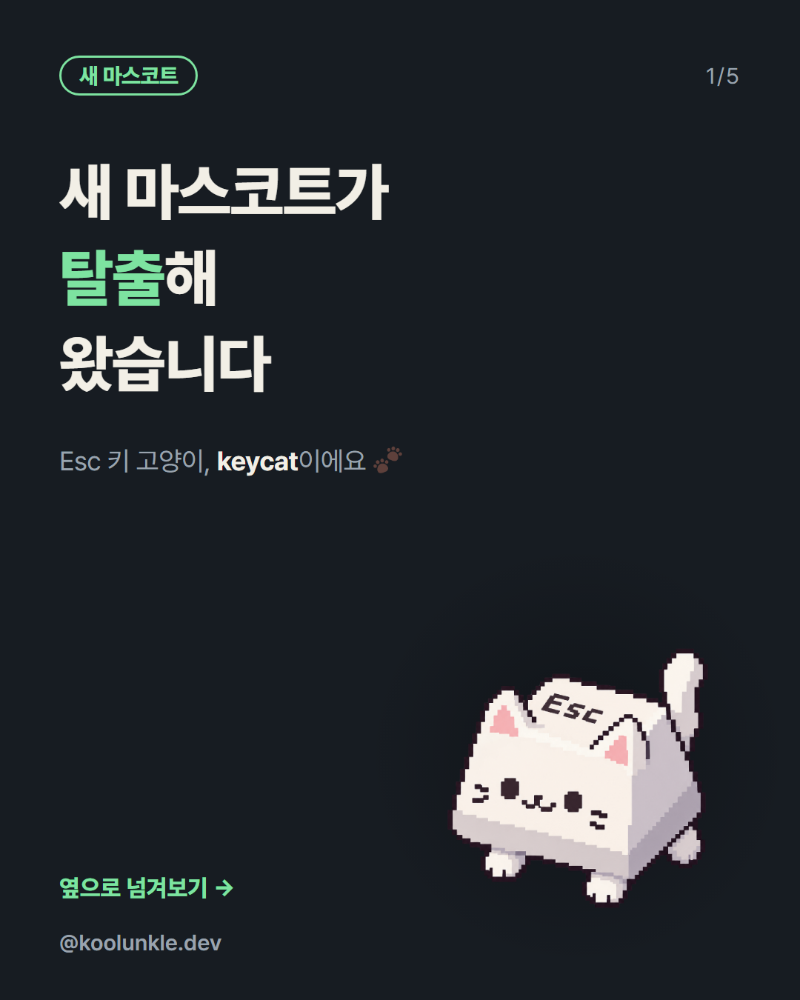

# koolunkle-dev-instagram

Instagram [@koolunkle.dev](https://www.instagram.com/koolunkle.dev/) 카드뉴스 원고와 렌더러입니다.
부트캠프 과제 PR 회고([gangnam3-java-oop](https://github.com/SurvivalCodingCampus/gangnam3-java-oop/pulls?q=is%3Apr+state%3Aclosed+author%3Akoolunkle))를 1080×1350 카드로 만듭니다.



## 구조

```
content/series.js     카드 원고 (데이터)
template/card.html    카드 템플릿
render.mjs            PNG 렌더러 → out/<id>/NN.png
out/                  렌더 결과 (게시용, 커밋함)
legacy/               원고 없이 PNG만 남은 초기 카드 (01, 03, 04, 05)
assets/characters/    캐릭터 투명 PNG와 추출 스크립트
```

## 사용법

```bash
node render.mjs          # 전체
node render.mjs 07 08    # 일부만
```

- Node.js 18+ 와 Chrome(또는 Edge)이 필요합니다. 다른 경로면 `CHROME` 환경 변수로 지정합니다.
- 브라우저 미리보기: `template/card.html?s=07&p=1` (`&c=keycat-smile`로 캐릭터만 바꿔 보기)
- 글꼴(Pretendard, Tossface, JetBrains Mono)은 CDN에서 불러오므로 렌더할 때 인터넷이 필요합니다.

### 새 카드 추가

1. `content/series.js`에 `{ id, pr, badge, slides: [...] }` 추가 (블록 종류는 파일 상단 주석과 `card.html`의 `blocks` 참고)
2. `node render.mjs <id>` 후 `out/<id>/` 확인
3. 아래 표에 한 줄 추가

## 캐릭터

| | 파일 | 사용 |
|---|---|---|
| keycat | `keycat-{smile,angry,anxious,healing}.png` | 09~ (현재) |
| K 키캡 | `{smile,angry,anxious,healing}.png` | 01~08 (은퇴) |

- keycat: `python -I assets/characters/split_keycats.py assets/characters` — `keycat.png` + `keycats.png`(3컷)에서 분리
- K 키캡: `python assets/characters/extract.py` — `legacy/` 카드에서 추출
- 스크립트 의존성: `pip install pillow numpy opencv-python`

## 작성 규칙

- 내용은 원본 PR과 일치시킨다. PR에서 고치지 않은 리뷰 봇 지적은 해결된 것처럼 쓰지 않는다.
- "리뷰 봇한테 혼난 썰" 시리즈는 봇의 지적 장면을 직접 보여준다.
- 다음 콘텐츠를 약속하는 문구("다음은 ~")는 쓰지 않는다.
- 갑작스러운 "범인은~" 전개 대신 앞 장면에서 자연스럽게 이어지게 한다.
- 회고 장(`오늘의 회고`)은 PR 회고 원문 기준. 원문이 아니면 `오늘의 교훈`으로 표기한다.
- 코드 한 줄은 고정폭 44~48자 이내.

### 캡션 형식

훅 한 줄 + 이모지 → 개념 설명 → 내 실수/경험 + "부트캠프 N일차"(PR 제목 기준) → 마지막 카드와 같은 댓글 질문

해시태그: 고정 8개 `#개발자 #코딩공부 #부트캠프 #자바 #코틀린 #개발자일상 #데브스타그램 #코딩생존기` + 주제 2개

## 폴더 ↔ PR

| 폴더 | PR | 시리즈 | 비고 |
|---|---|---|---|
| legacy/01 | #30 | AI가 또 거짓말함 #1 | PNG만 있음 |
| legacy/03 | #70 | 리뷰 봇한테 혼난 썰 #1 | PNG만 있음 |
| legacy/04 | #42 | 생존 일지 #1 | PNG만 있음 |
| legacy/05 | #102 | 일상 비유로 배우는 개념 #1 | PNG만 있음 |
| 06 | #65 | 리뷰 봇한테 혼난 썰 #2 | 재구성 |
| 07 | #5 | 생존 일지 #2 | 테스트 중심으로 재구성 |
| 08 | #13 | 생존 일지 #3 | 경계값+가드 중심으로 재구성 (리뷰 봇 일화 제외) |
| keycat | - | 새 마스코트 소개 | 08과 09 사이에 게시 |
| 09 | #23 | 리뷰 봇한테 혼난 썰 #3 | |
| 10 | #47 | 리뷰 봇한테 혼난 썰 #4 | |
| 11 | #55 | 일상 비유로 배우는 개념 #2 | |
| 12 | #61 | 일상 비유로 배우는 개념 #3 | |
| 13 | #75 | 리뷰 봇한테 혼난 썰 #5 | File 경로 → resources + ClassLoader 한 줄기로 재구성 (toInt 일화 제외) |
| 14 | #80 | 일상 비유로 배우는 개념 #4 | 식당 비유 → 내 과제(DataSource) 중심 (미반영 리뷰 봇 지적 제외) |
| 15 | #85 | 일상 비유로 배우는 개념 #5 | 대역 비유 → 실제 Fake DataSource·Repository 테스트 (미반영 리뷰 봇 지적 제외) |
| 16 | #90 | 리뷰 봇한테 혼난 썰 #6 | 과제 코드·고친 TIL을 PR 실제 내용으로 |
| 17 | #93 | 생존 일지 #4 | 솔직 후기+회고 통합, 코드는 PR 실제 주입 방식 |
| 18 | #98 | 일상 비유로 배우는 개념 #6 | 미반영 타임아웃 지적 → Mapper 테스트로 교체 |
| 19 | #106 | AI가 또 거짓말함 #2 | 오타 일화를 "검증은 나에게도"로 연결, 회고는 PR 원문 기준 |

## 라이선스

- 코드(`render.mjs`, `template/`, `assets/characters/*.py`): [MIT](LICENSE)
- 콘텐츠(원고, 카드 이미지, 캐릭터): © koolunkle, All rights reserved. 무단 사용·재배포 금지
- 글꼴: Pretendard, Tossface — SIL Open Font License 1.1 (CDN 로드, 저장소에 포함하지 않음)
